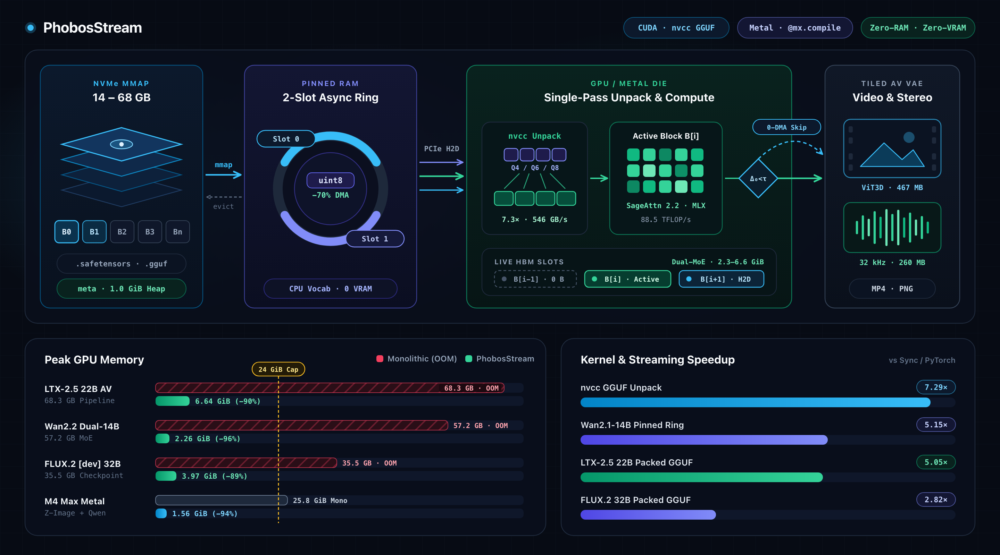

<div align="center">


# ComfyUI-PhobosStream

**Zero-RAM & Zero-VRAM Block-Streaming Extension for `22B–33B+` Video, Audio-Video & Image Models in ComfyUI**

[](https://registry.comfy.org/publishers/martianacademy/nodes/comfyui-phobosstream)
[](https://pypi.org/project/phobos-stream/)
[](https://colab.research.google.com/github/martianacademy/phobos-stream/blob/main/notebooks/MiniMax_H3_Free_T4_PhobosStream.ipynb)
[](LICENSE)

</div>

---

**ComfyUI-PhobosStream** runs **`22B–33B+` (`14 GB–68 GB+`)** `.safetensors` and `.gguf` Diffusion Transformers — **`FLUX.2 [dev]` (`32B`)**, **`LTX-2.5` (`22B` Audio+Video + `Gemma-4 12B`)**, **`Wan2.2-A14B` (`57.2 GB` Dual-Expert MoE)**, and **`MiniMax-H3` (`33B` Video+Audio)** — inside **`2.3–6.6 GiB` Peak VRAM** and **`~1.0 GiB` Host Heap RAM** with zero `ComfyUI-GGUF` dependency.

<p align="center">
  
</p>

---

## Benchmarks (Enforced `24.0 GiB` Consumer GPU Ceiling)

| Model (`Checkpoint Footprint`) | Stock ComfyUI (`24.0 GiB` Cap) | PhobosStream Peak VRAM | Host Heap (`VmData`) | Latency (`sec/step`) | Fidelity |
| :--- | :---: | :---: | :---: | :---: | :---: |
| **`FLUX.2 [dev]` `32B`** (`35.5 GB` FP8 / `35.0 GB` `Q8_0.gguf`, `1024×1024`) | `CUDA OOM` (`24.5 GB`) + `34.9 GB` Heap | **`4,063.8 MB` (`3.97 GiB`)** | **`1,023.7 MB` (`-97.1%`)** | **`17.11 s` (`4.28 s`)** | `Q8_0` Ref (`64.5 GB` BF16 class) |
| **`FLUX.2 [dev]` `32B`** (`19.3 GB` `Q4_K_S.gguf`, `PackedGGUFShadow`) | `CUDA OOM` | **`5,935.8 MB`** *(CPU)* / **`4,063.8 MB`** *(mmap)* | **`1,069.9 MB` (`-96.9%`)** | **`6.06 s` (`1.51 s`, `2.82×`)** | **`44.04 dB` PSNR (`0.9974` cos)** |
| **`LTX-2.5` `Gemma-4 12B` Encoder** (`26.26 GB` BF16, 48 blocks) | `CUDA OOM` (`23.6 GB + 1.44 GiB`) | **`6,578.0 MB`** (`2,226 MB` post-encode) | Streamed | **`8.81 s`** | Lossless BF16 |
| **`LTX-2.5` `22B` Audio+Video** (`42.02 GB` BF16, Joint AV `NestedTensor`) | `CUDA OOM` (`23.9 GB`) + `41.1 GB` Heap | **`6,797.8 MB` (`6.64 GiB`)** | **`1,048.4 MB` (`-97.4%`)** | **`29.03 s` (`7.26 s`)** | Joint Video + Audio BF16 Ref |
| **`LTX-2.5` `22B` Audio+Video** (`22.8 GB` `Q8_0` / `13.6 GB` `Q4_K_M`) | `CUDA OOM` | **`6,796.7 MB`** / **`7,537.2 MB`** | **`1,075–1,088 MB`** | **`25.85 s`** / **`5.75 s` (`1.44 s`, `5.05×`)** | `41.61 dB` / `34.72 dB` Audio PSNR |
| **`Wan2.2-T2V-A14B` `27B` MoE** (`57.16 GB` Dual `14B` High+Low FP16) | `CUDA OOM` (`24.5 GB`) + `31.1 GB+` Heap | **`2,314.7 MB` (`2.26 GiB`)** | **`1,032.8 MB` (`-96.7%`)** | **`34.15 s` (`5.69 s`, `2.14 s` load)** | Lossless Dual-Expert Handoff |
| **`MiniMax-H3` `33B` Video+Audio VAE** (`4.85 GB` `ViT3D` + `32 kHz` Stereo, `141f`) | `CUDA OOM` on `14.5 GiB` T4 | **`466.8 MB`** *(Video)* / **`259.6 MB`** *(Audio)* | Fits `12 GiB` VM | `38.37 s` (`hybrid_budget`) | **`0.0` Bit-Exact Diff (`96.8%` saved)** |

<p align="center">
  
  <br/>
  <sub><b>MiniMax-H3 (141 frames @ 24fps + 32 kHz Stereo Audio)</b> — 36-block <code>4.85 GB</code> ViT3D Video VAE streamed in <b>466.8 MB Peak VRAM</b>.</sub>
</p>

---

## Installation

### Option 1: Comfy Registry CLI (Recommended)
```bash
comfy node install comfyui-phobosstream
```

### Option 2: ComfyUI Manager
Open **ComfyUI Manager → Install Custom Nodes**, search **`ComfyUI-PhobosStream`**, install, and restart ComfyUI.

### Option 3: Git Clone
```bash
cd ComfyUI/custom_nodes/
git clone https://github.com/martianacademy/ComfyUI-PhobosStream.git
pip install -r ComfyUI-PhobosStream/requirements.txt
```

---

## Node Reference (Category: `PhobosStream` — 9 Nodes)

| # | Node | Signature | Purpose |
| :---: | :--- | :---: | :--- |
| **1** | **`PhobosZeroRAMLoader`** | `→ MODEL` | Loads `14 GB–68 GB+` `.safetensors` & `.gguf` (`Q8_0`, `Q6_K`, `Q5_K`, `Q4_K`, `Q4_1`, `Q4_0`, `BF16`, `F16`) directly onto `meta` in `~1.0 GB` Host Heap (`mmap_stream`, `hybrid_budget`, or compressed `cpu_offload`). |
| **2** | **`PhobosCLIPStreamPatcher`** | `CLIP → CLIP` | Streams `Gemma-4 12B`, `Mistral-3`, `UMT5-XXL`, `T5-XXL`, `Qwen-VL`, and `DualCLIP` encoders block-by-block with `0 MB`-VRAM CPU giant-vocabulary lookup and post-encode eviction. |
| **3** | **`PhobosBlockStreamPatcher`** | `MODEL → MODEL` | Drop-in 3-tier block streamer (`hybrid_budget`, `cpu_offload`, `mmap_stream`) compatible with standard ComfyUI LoRA, ControlNet, FLUX, LTX, and Wan workflows. |
| **4** | **`PhobosFirstBlockCache`** | `MODEL → MODEL` | Multi-group Zero-DMA Residual Cache (`1.50×–1.94×` faster) with automatic `cond`/`uncond` CFG isolation across `(x)`, `(img, txt)`, and `(vx, ax)` blocks. |
| **5** | **`PhobosVAEStreamPatcher`** | `VAE → VAE` | Streams heavy 3D/`ViT3D` Video VAEs (`466.8 MB` Peak VRAM) and applies crossfaded chunk decoding to 3D/4D `32 kHz` Stereo Audio VAEs (`259.6 MB`). |
| **6** | **`PhobosStageOffloadPipeline`** | `→ IMAGE` | All-in-one 3-stage sequential offloader (`Text Encoder → Unload → DiT → Unload → Tiled VAE`). |
| **7–9** | **`PhobosStreamLoader` / `Sampler` / `VAEDecode`** | Modular | Stage-isolated loader, sampler, and tiled VAE decode nodes (`workflows/minimax_h3_lowvram.json`). |

---

## License

Released under the [MIT License](LICENSE).
